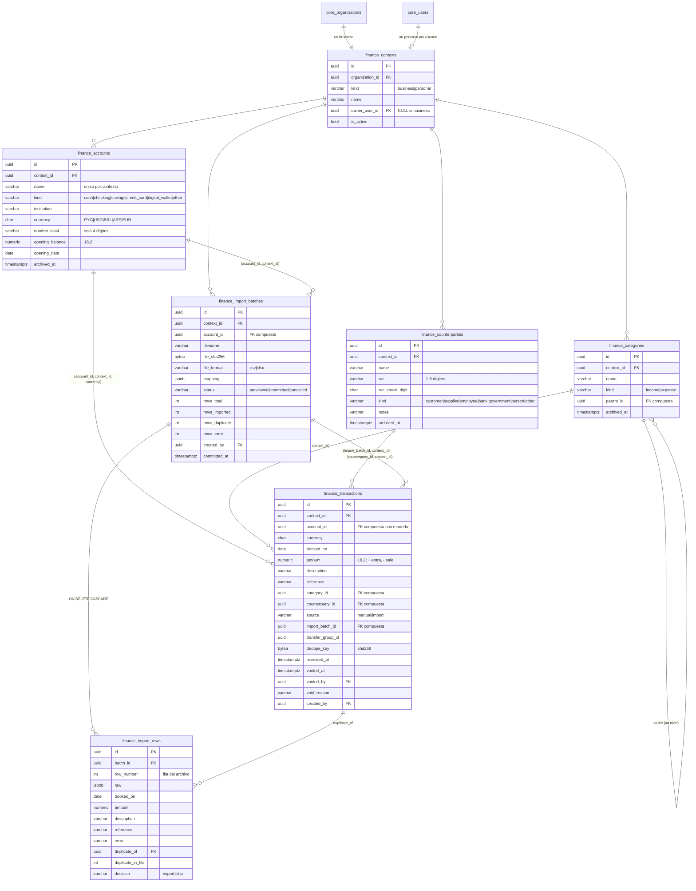
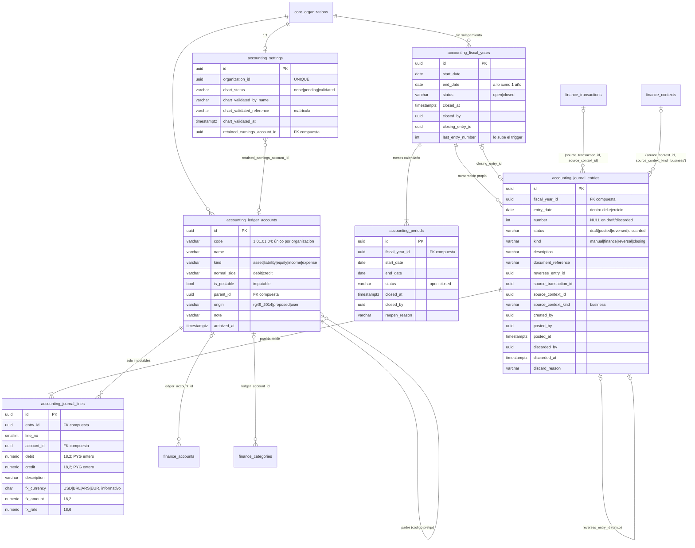
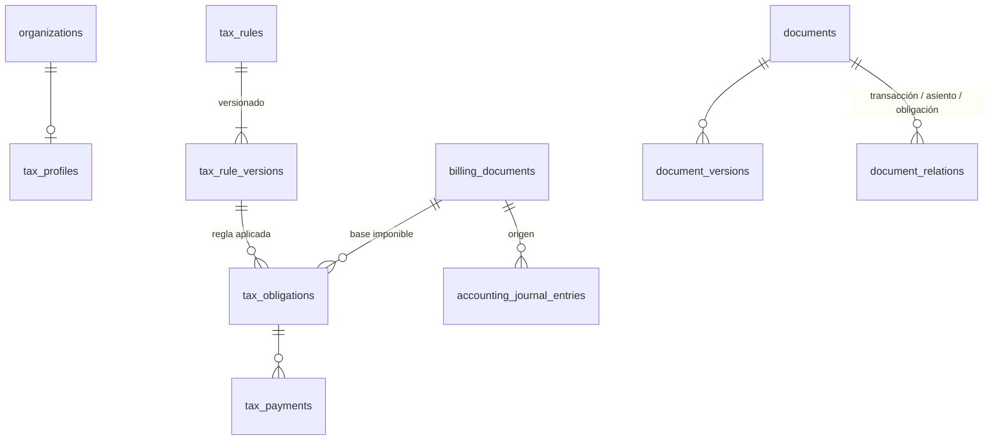

# Esquema de base de datos

PostgreSQL 18. Migraciones en `backend/migrations` (Alembic). Convenciones:

- PK `uuid` con `uuidv7()` (ordenadas por tiempo). Excepción: catálogos con código natural (`roles.code`, `permissions.code`).
- `timestamptz` en todas las fechas-hora; `date` para fechas contables y fiscales.
- Importes `NUMERIC(18,2)` + `currency char(3)` (D-026; desde la fase 2). Nunca `float`.
- Nombres de restricciones estables (`pk_`, `fk_`, `uq_`, `ck_`, `ix_`).
- Soft delete **no** se usa por defecto: los registros contables no se borran (se revierten), los movimientos financieros se anulan (`voided_at`) y los maestros se desactivan o archivan (`is_active`, `archived_at`).
- Todo dato de negocio lleva `organization_id`.

## Implementado (migración `0001`)

### Restricciones e invariantes en la base
| Objeto | Regla |
|---|---|
| `uq_users_email_lower` | Email único sin distinguir mayúsculas |
| `ck_organizations_ruc_*` | RUC 1-8 dígitos, DV 1 dígito, ambos o ninguno |
| `uq_organization_members_organization_id_user_id` | Una membresía por usuario y organización |
| `ck_user_sessions_expires_after_creation` | Vencimiento posterior a la creación |
| `audit.chain_audit_log()` (trigger) | Asigna `seq` y la cadena de hashes bajo candado |
| `audit.reject_change()` (triggers) | `audit_logs` y `security_events`: sin UPDATE, DELETE ni TRUNCATE |
| `audit.log_row_hash()` | Hash canónico (lo usan el trigger y la verificación) |

### Datos iniciales (en la misma migración)
Permisos `organization.read`, `organization.manage`, `users.read`, `users.manage`, `audit.read`; roles `owner`, `admin`, `accountant`, `viewer` y sus vínculos. Una prueba verifica que coincidan con `app/core/permissions.py`.

## Implementado (migración `0002` — finanzas)

Esquema `finance`. Especificación: `docs/specs/FASE2_FINANZAS.md` (D-023 a D-027). Todas las tablas llevan `id uuid` (`uuidv7()`), `created_at` y `updated_at`.

### Restricciones e invariantes en la base (finanzas)
| Objeto | Regla |
|---|---|
| `uq_contexts_business_per_org` (parcial) | Exactamente un contexto `business` por organización |
| `uq_contexts_personal_per_user` (parcial) | Como máximo un contexto `personal` por usuario y organización |
| `ck_contexts_owner_matches_kind` | `owner_user_id` NULL si `business`, obligatorio si `personal` |
| `uq_{accounts,categories,counterparties,import_batches}_id_context_id` | Destino de las claves foráneas compuestas (D-025) |
| `uq_accounts_id_context_id_currency` | Destino de la FK que fija la moneda del movimiento |
| `fk_transactions_account_id_accounts` | `(account_id, context_id, currency)`: la cuenta es del mismo contexto y de la misma moneda; además impide cambiar la moneda de una cuenta con movimientos |
| `fk_transactions_{category,counterparty,import_batch}_id_*` | `(x_id, context_id)`: del mismo contexto |
| `fk_categories_parent_id_categories` | `(parent_id, context_id)`: el padre es del mismo contexto (el nivel único se valida en el servicio) |
| `fk_import_batches_account_id_accounts` | `(account_id, context_id)` |
| `uq_accounts_context_id_name` | Nombre de cuenta único por contexto |
| `uq_categories_context_id_parent_id_name` | `NULLS NOT DISTINCT`: nombre único por nivel |
| `uq_counterparties_ruc_per_context` (parcial) | Un RUC por contexto |
| `ck_counterparties_ruc_*` | Mismas reglas de RUC y DV que `core.organizations` |
| `ck_accounts_currency_valid` | Catálogo de monedas de `finance/money.py` |
| `ck_accounts_number_last4_digits` | Solo los últimos 4 dígitos, nunca el número completo |
| `ck_accounts_pyg_integer`, `ck_transactions_pyg_integer` | PYG sin decimales |
| `ck_transactions_amount_not_zero` | Importe distinto de cero |
| `ck_transactions_import_has_batch` | `source = 'import'` si y solo si hay lote |
| `ck_transactions_void_complete`, `ck_transactions_void_reason_length` | Anulación: fecha, usuario y motivo juntos; motivo de 3 caracteres o más |
| `ck_transactions_transfer_without_category` | Una transferencia no lleva categoría |
| `ck_import_batches_committed` | `committed_at` si y solo si `status = 'committed'` |
| `uq_import_rows_batch_id_row_number` | Una fila por número dentro del lote |
| `ix_transactions_context_booked` | `(context_id, booked_on DESC, id DESC)`: listado paginado |
| `ix_transactions_account_dedupe` | `(account_id, dedupe_key)` **no único**: el duplicado se señala, no se prohíbe |

### Rendimiento del resumen (índices evaluados, D-033)
Requisito: con 100.000 movimientos, `GET /transactions` (primera página) y `GET /summary` de 12 meses responden en < 300 ms (objetivo de margen: resumen < 120 ms con la máquina libre). **La fase 2 no agregó índices** (ninguna migración de índices), porque ninguno dio una mejora medible. Lo que cambió es la consulta (`app/modules/finance/summary.py`): una pasada en lugar de tres.

| Consulta (base con `VACUUM ANALYZE`, máquina libre) | Plan | Tiempo de base |
|---|---|---|
| Listado, primera página | `Index Scan using ix_transactions_context_booked` + `LIMIT 50`; 53 buffers | 0,1-0,2 ms (el pedido completo, ~9 ms, es autenticación y serialización) |
| Resumen **antes** | 3 consultas: `HashAggregate` sobre `Bitmap Heap Scan` por `ix_transactions_account_booked` para el flujo mensual con `to_char` (49.182 filas) y otro igual para el gasto por categoría (32.789 filas); `HashAggregate` sobre `Seq Scan` para los saldos (100.000 filas) | 36 + 16 + 25 ≈ 77 ms |
| Resumen **después** | 1 consulta: `HashAggregate` (clave: cuenta, mes, categoría, signo; 50 grupos) sobre un único `Seq Scan` (100.000 filas) | ≈ 39 ms |

Medianas del pedido HTTP completo (`bench`: base real y confirmada, sembrada como la prueba de rendimiento; 15-21 corridas tras calentar; "cargada" = 8 procesos al 100 % más otro agente trabajando en la misma máquina):

| Estado | Listado | Resumen antes | Resumen después |
|---|---|---|---|
| Sin `VACUUM` (solo `ANALYZE`), máquina libre | 9 ms | 82 ms | 48 ms |
| Con `VACUUM ANALYZE`, máquina libre | 9 ms | 76 ms | 45 ms |
| Sin `VACUUM`, máquina cargada | 23-44 ms | 222-278 ms | 156-158 ms |
| Con `VACUUM ANALYZE`, máquina cargada | 20-42 ms | 237-294 ms | 154-156 ms |
| Dentro de la prueba `slow` (filas sin confirmar), máquina libre | 10 ms | 65-70 ms | 49-69 ms |
| Dentro de la prueba `slow`, máquina cargada | — | 383-414 ms | 223-289 ms |

El listado casi no depende de la base: lo que crece con la carga es el trabajo de Python (siete consultas pequeñas de sesión, permisos y contexto por pedido). Dentro de la prueba, el planificador elegía planes paralelos (`Parallel Seq Scan`) para las tres consultas antiguas, lo que oculta parte de la mejora con la máquina libre y no ayuda con la máquina cargada.

Índices evaluados y **descartados** (medidos con `EXPLAIN (ANALYZE, BUFFERS)` y con el CPU del proceso de PostgreSQL, intercalando las variantes):
- `(context_id, booked_on) INCLUDE (account_id, currency, amount, category_id, transfer_group_id) WHERE voided_at IS NULL` (8,7 MB por 100.000 filas): el planificador no lo elige por costo; forzado (`enable_seqscan = off`) con `VACUUM`, el solo-índice ganó ~15 % por reloj (47 contra 57 ms) y empató en CPU con filas anchas (≈ 116 contra ≈ 118 ms). Sin `VACUUM` no puede evitar leer el montón.
- `(context_id, account_id, booked_on) INCLUDE (amount) WHERE voided_at IS NULL`: con `VACUUM` el planificador sí lo usa para los saldos (`GroupAggregate` sobre `Index Only Scan`, 16 ms contra 26 ms), pero separar saldos y flujo en dos subconsultas sumó lo mismo que la pasada única (37 contra 38 ms) y solo vale con `VACUUM`.
- Agregados filtrados + `GROUPING SETS`: igual de rápido que las tres consultas (85 contra 87 ms) antes de simplificar; se eligió la agrupación por signo, que lleva una sola suma por fila.
- Paralelismo forzado (`parallel_setup_cost = 0`): más lento con la máquina cargada, y en Windows lanzar procesos de trabajo es caro; no se fuerza. `jit` no se activa en estas consultas (costo ≪ 100.000).

### Datos iniciales (migración `0002`)
Permisos `finance.read` (owner, admin, accountant, viewer) y `finance.manage` (owner, admin, accountant), y el contexto `business` ("Empresa") de cada organización existente. Los permisos se insertan con `ON CONFLICT DO NOTHING` porque la `0001` carga el catálogo vivo de `app/core/permissions.py` (en una base nueva ya los trae).

## Implementado (migración `0003` — contabilidad, núcleo)

Esquema `accounting`. Especificación: `docs/specs/FASE3_CONTABILIDAD.md` (D-035 a D-043; decisiones de implementación D-044 a D-055). Todas las tablas llevan `id uuid` (`uuidv7()`), `organization_id`, `created_at` y `updated_at`. Las tablas referenciadas tienen `UNIQUE (id, organization_id)` y se referencian con claves foráneas compuestas `(x_id, organization_id)`: un asiento no puede usar una cuenta, un ejercicio o un asiento de otra organización. La 0003 requiere la extensión `btree_gist` (D-054).

Cambios en tablas de finanzas: `finance.contexts` recibe `UNIQUE (id, kind)` (D-035) y `UNIQUE (id, organization_id)`; `finance.transactions`, `UNIQUE (id, context_id)` (D-044); `finance.accounts` y `finance.categories`, `ledger_account_id uuid NULL` FK `accounting.ledger_accounts` (que sea del contexto `business`, de la misma organización, imputable y del tipo correcto lo valida `accounting/finance_link.py`).

### Restricciones
| Restricción | Qué impide |
|---|---|
| `ck_ledger_accounts_code_format` | Código que no sea `^[0-9]+(\.[0-9]+)*$` |
| `uq_ledger_accounts_organization_id_code` | Dos cuentas con el mismo código en la organización |
| `fk_ledger_accounts_parent_id_ledger_accounts`, `ck_ledger_accounts_not_own_parent` | `(parent_id, organization_id)`: padre de otra organización o la cuenta como su propio padre |
| `ck_ledger_accounts_{kind,normal_side,origin}_valid`, `ck_ledger_accounts_name_not_blank` | Valores fuera de catálogo; nombre vacío |
| `uq_settings_organization_id` | Más de una configuración por organización (D-045) |
| `ck_settings_chart_validation_complete` | Plan `validated` sin nombre, matrícula y fecha del contador, o esos datos con otro estado (BR-ACC-10) |
| `fk_settings_retained_earnings_account_id_ledger_accounts` | `(retained_earnings_account_id, organization_id)`: cuenta de otra organización |
| `ck_fiscal_years_dates_ordered`, `ck_fiscal_years_at_most_one_year` | Fin anterior al inicio; ejercicio de más de 12 meses (`end_date < start_date + 1 año`) |
| `ex_fiscal_years_no_overlap` | `EXCLUDE USING gist (organization_id WITH =, daterange(start_date, end_date, '[]') WITH &&)`: ejercicios solapados |
| `ck_fiscal_years_closed_complete`, `ck_fiscal_years_closing_entry_when_closed` | Cerrado sin fecha y usuario; refundición en un ejercicio abierto |
| `ck_fiscal_years_last_entry_number_non_negative` | Contador negativo |
| `uq_periods_fiscal_year_id_start_date`, `ck_periods_dates_ordered`, `ck_periods_closed_complete`, `ck_periods_reopen_reason_length` | Períodos repetidos o mal formados; cerrado sin fecha y usuario; motivo de reapertura de menos de 3 caracteres |
| `ck_journal_entries_number_when_posted`, `ck_journal_entries_number_positive`, `uq_journal_entries_fiscal_year_id_number` | Número en un borrador o descartado; asiento contabilizado sin número; número repetido en el ejercicio |
| `ck_journal_entries_posted_complete`, `ck_journal_entries_discarded_complete`, `ck_journal_entries_discard_reason_length` | Contabilizado sin usuario y fecha; descartado sin usuario, fecha y motivo (BR-ACC-04) |
| `ck_journal_entries_reversal_has_original`, `ck_journal_entries_not_self`, `uq_journal_entries_reverses_entry_id` | `(kind = 'reversal') = (reverses_entry_id IS NOT NULL)`; revertirse a sí mismo; revertir dos veces |
| `ck_journal_entries_source_complete`, `ck_journal_entries_source_business_only`, `ck_journal_entries_finance_has_source` | Origen incompleto; origen personal (D-035); `kind = 'finance'` si y solo si hay movimiento de origen |
| `fk_journal_entries_source_transaction_id_transactions` | `(source_transaction_id, source_context_id) → finance.transactions (id, context_id)`: el movimiento es de ese contexto |
| `fk_journal_entries_source_context_kind_contexts` | `(source_context_id, source_context_kind) → finance.contexts (id, kind)`: el contexto es de verdad `business` |
| `fk_journal_entries_source_context_org_contexts` | `(source_context_id, organization_id) → finance.contexts (id, organization_id)`: el contexto es de la misma organización (D-044) |
| `uq_journal_entries_live_source` (parcial `WHERE status IN ('draft','posted')`) | Dos asientos vivos para el mismo movimiento (D-041) |
| `uq_journal_entries_closing_per_year` (parcial `WHERE kind = 'closing' AND status IN ('draft','posted')`) | Dos refundiciones en el mismo ejercicio |
| `ck_journal_lines_debit_xor_credit`, `ck_journal_lines_amounts_non_negative`, `ck_journal_lines_pyg_integer` | Línea con debe y haber, sin ninguno, negativa o con decimales en guaraníes (BR-ACC-05) |
| `ck_journal_lines_fx_complete`, `ck_journal_lines_fx_currency_valid`, `ck_journal_lines_fx_{amount,rate}_positive` | Moneda extranjera incompleta, `PYG` como moneda extranjera, importes o cotización no positivos (D-036) |
| `fk_journal_lines_account_id_ledger_accounts`, `fk_journal_lines_entry_id_journal_entries` | `(x_id, organization_id)`: cuenta o asiento de otra organización |
| `ix_journal_entries_org_date_number`, `ix_journal_entries_year_status`, `ix_journal_lines_account_entry`, `ix_ledger_accounts_parent` | Índices: diario y listados, borradores por ejercicio, mayor y sumas por cuenta, hijos de una cuenta |

### Triggers (la base es la última defensa, BR-ACC-01/02/03)
Funciones PL/pgSQL `BEFORE` en el esquema `accounting`. Rechazan con `SQLSTATE 23000` y un nombre estable en `CONSTRAINT` (`diag.constraint_name`), que el servicio traduce a un error legible (`accounting/common.py`). Cada uno tiene una prueba con SQL directo en `tests/test_accounting_db_triggers.py` que falla si se quita el trigger.

| Trigger (tabla) | Nombre del rechazo | Qué impide |
|---|---|---|
| `ledger_accounts_guard` (`ledger_accounts`, INSERT/UPDATE) | `trg_ledger_accounts_parent_prefix` | Código que no empieza con el del padre más un punto |
| | `trg_ledger_accounts_parent_postable` | Colgar una cuenta de una imputable |
| | `trg_ledger_accounts_in_use` | Cambiar código, tipo, naturaleza o imputabilidad de una cuenta con líneas (BR-ACC-09) |
| | `trg_ledger_accounts_has_children` | Cambiar el código de una cuenta con hijas |
| `fiscal_years_guard` (`fiscal_years`, UPDATE) | `trg_fiscal_years_closed_final` | Modificar o reabrir un ejercicio cerrado |
| | `trg_fiscal_years_dates_fixed` | Cambiar las fechas de un ejercicio |
| | `trg_fiscal_years_numbering` | Que `last_entry_number` retroceda (D-049) |
| `periods_guard` (`periods`, UPDATE) | `trg_periods_dates_fixed`, `trg_periods_year_closed` | Cambiar fechas; cerrar o reabrir un período de un ejercicio cerrado |
| `journal_entries_guard` (`journal_entries`, INSERT/UPDATE/DELETE) | `trg_journal_entries_no_delete` | Borrar cualquier asiento |
| | `trg_journal_entries_insert_draft` | Insertar un asiento que no sea borrador |
| | `trg_journal_entries_final` | Modificar un asiento `reversed` o `discarded` |
| | `trg_journal_entries_posted_immutable` | Cambiar cualquier columna de un asiento `posted` (solo admite `status → reversed`) |
| | `trg_journal_entries_reversal_missing` | Pasar a `reversed` sin una reversión contabilizada |
| | `trg_journal_entries_date_outside_year` | Fecha fuera de su ejercicio |
| | `trg_journal_entries_number_assigned` | Número puesto a mano (lo asigna el trigger, D-049) |
| | `trg_journal_entries_year_closed`, `trg_journal_entries_period_closed` | Contabilizar en un ejercicio o período cerrado (BR-ACC-03) |
| | `trg_journal_entries_min_lines`, `trg_journal_entries_unbalanced` | Contabilizar con menos de dos líneas o con Σ debe ≠ Σ haber (BR-ACC-01) |
| | `trg_journal_entries_account_not_postable` | Contabilizar con una cuenta que se volvió agrupadora o se archivó después del borrador |
| | `trg_journal_entries_closing_invalid` | Refundición que no va fechada el último día o con períodos abiertos (D-050) |
| | `trg_journal_entries_reversal_invalid`, `trg_journal_entries_reversal_mismatch` | Reversión de un asiento no contabilizado, o con líneas que no son las del original invertidas (D-051) |
| | `trg_journal_entries_source_voided` | Contabilizar el asiento de un movimiento anulado (BR-ACC-11) |
| `journal_lines_guard` (`journal_lines`, INSERT/UPDATE/DELETE) | `trg_journal_lines_entry_not_draft` | Tocar líneas de un asiento que no es borrador (BR-ACC-02) |
| | `trg_journal_lines_account_not_postable` | Línea con cuenta agrupadora o archivada (BR-ACC-09) |
| `fiscal_years_no_delete`, `periods_no_delete` | `trg_fiscal_years_no_delete`, `trg_periods_no_delete` | Borrar ejercicios o períodos |
| `*_no_truncate` (asientos, líneas, ejercicios, períodos) | `trg_<tabla>_no_delete` | `TRUNCATE` |

Al pasar a `posted`, el trigger toma `FOR SHARE` el período y, si hay, el movimiento de origen, y numera con `UPDATE accounting.fiscal_years … RETURNING` (candado de fila, sin huecos). El trigger de líneas toma `FOR SHARE` el asiento: una línea no puede colarse mientras otro lo contabiliza.

### Rendimiento de los reportes (D-042, D-055)
Los reportes se calculan al vuelo (una consulta agrupada por cuenta con `ix_journal_lines_account_entry`); no hay tablas de saldos. Con 100.000 líneas contabilizadas (PostgreSQL 18.7 en Docker, mediana de 9 tras 2 de calentamiento, dentro de la prueba `slow`): balance de comprobación anual ~32 ms, mayor de una cuenta con 20.000 líneas (primera página de 200) ~40 ms, balance general ~44 ms. Requisito: < 300 ms.

### Datos iniciales (migración `0003`)
Permisos `accounting.read` (owner, admin, accountant, viewer), `accounting.manage` (owner, admin, accountant) y `accounting.post` (owner, accountant), con copia congelada en la migración (D-031). La bajada borra los permisos, las columnas `ledger_account_id`, las tablas, las funciones y el esquema, y las restricciones nuevas de finanzas; deja `btree_gist`.

## Modelo objetivo (fases 4 a 7)

Se implementa por fases; cada tabla nace con su migración, su prueba y su pantalla. Lo que sigue es el diseño de referencia y **se revisará** en cada fase. Finanzas (fase 2) y el núcleo contable (fase 3) ya están implementados (secciones anteriores): en el diagrama aparecen solo como punto de enganche.

### Decisiones de modelado clave
- **Contexto financiero**: implementado en la fase 2 como `finance.contexts`. Los asientos de la fase 3 referencian el contexto `business` con claves foráneas compuestas (D-035, D-044). Lo consolidado es una **vista**, nunca datos mezclados.
- **Asientos**: implementados en la fase 3 (`accounting.journal_entries`, ver arriba). Pendiente para fases siguientes: conciliación bancaria y el vínculo con documentos y facturas.
- **Reglas tributarias**: `tax_rule_versions` con `valid_from`, `valid_to`, `source_url`, `legal_reference`, `published_at`, `consulted_at`, `validation_status ∈ {pending, verified, deprecated}`, `reviewed_by`. Las obligaciones guardan la versión aplicada. Se cargan como datos, no como código.
- **Facturación**: esquema `billing` propio del servicio SIFEN (fase 5), referenciado desde contabilidad y tributación por `billing_documents.id`.
- **IA**: `ai.ai_interactions`, `ai.ai_tool_executions` (entrada, salida, duración, usuario) y `ai.ai_approvals` (borrador → aprobado/rechazado por un humano).
