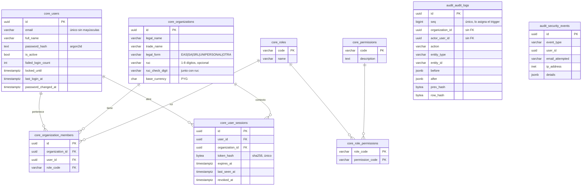
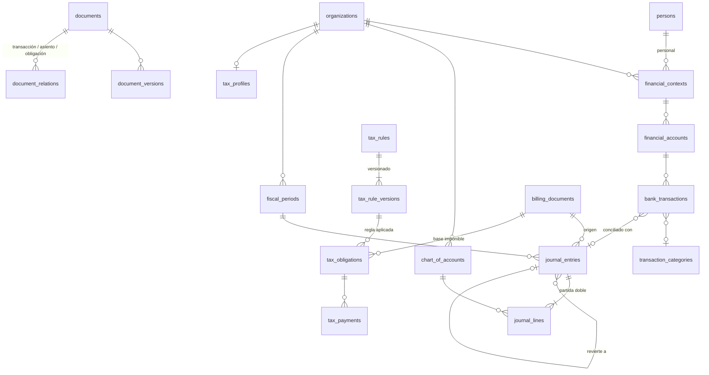

# Esquema de base de datos

PostgreSQL 18. Migraciones en `backend/migrations` (Alembic). Convenciones:

- PK `uuid` con `uuidv7()` (ordenadas por tiempo). Excepción: catálogos con código natural (`roles.code`, `permissions.code`).
- `timestamptz` en todas las fechas-hora; `date` para fechas contables y fiscales.
- Importes `NUMERIC(20,4)` + `currency char(3)` (desde fase 2).
- Nombres de restricciones estables (`pk_`, `fk_`, `uq_`, `ck_`, `ix_`).
- Soft delete **no** se usa por defecto: los registros contables no se borran (se revierten) y los maestros se desactivan con `is_active`.
- Todo dato de negocio lleva `organization_id`.

## Implementado (migración `0001`)

### Restricciones e invariantes en la base
| Objeto | Regla |
|---|---|
| `uq_users_email_lower` | Email único sin distinguir mayúsculas |
| `ck_organizations_ruc_*` | RUC 1-8 dígitos, DV 1 dígito, ambos o ninguno |
| `uq_organization_members_organization_id_user_id` | Una membresía por usuario y organización |
| `ck_user_sessions_expires_after_creation` | Vencimiento posterior a la creación |
| `audit.chain_audit_log()` (trigger) | Asigna `seq` y la cadena de hashes bajo candado |
| `audit.reject_change()` (triggers) | `audit_logs` y `security_events`: sin UPDATE, DELETE ni TRUNCATE |
| `audit.log_row_hash()` | Hash canónico (lo usan el trigger y la verificación) |

### Datos iniciales (en la misma migración)
Permisos `organization.read`, `organization.manage`, `users.read`, `users.manage`, `audit.read`; roles `owner`, `admin`, `accountant`, `viewer` y sus vínculos. Una prueba verifica que coincidan con `app/core/permissions.py`.

## Modelo objetivo (fases 2 a 7)

Se implementa por fases; cada tabla nace con su migración, su prueba y su pantalla. Lo que sigue es el diseño de referencia y **se revisará** en cada fase.

### Decisiones de modelado clave
- **Contexto financiero** (`core.financial_contexts`): `kind ∈ {personal, business}`, dueño = persona u organización. Toda cuenta y movimiento pertenece a un contexto; una restricción impide que un asiento empresarial use una cuenta de un contexto personal. Lo consolidado es una **vista**, nunca datos mezclados.
- **Asientos**: `journal_entries.status ∈ {draft, posted, reversed}`. Un trigger rechaza modificar líneas de un asiento `posted` y contabilizar en un período cerrado; otro valida `Σ debe = Σ haber` por moneda al pasar a `posted`. La corrección es un asiento de reversión (`reverses_entry_id`).
- **Reglas tributarias**: `tax_rule_versions` con `valid_from`, `valid_to`, `source_url`, `legal_reference`, `published_at`, `consulted_at`, `validation_status ∈ {pending, verified, deprecated}`, `reviewed_by`. Las obligaciones guardan la versión aplicada. Se cargan como datos, no como código.
- **Facturación**: esquema `billing` propio del servicio SIFEN (fase 5), referenciado desde contabilidad y tributación por `billing_documents.id`.
- **IA**: `ai.ai_interactions`, `ai.ai_tool_executions` (entrada, salida, duración, usuario) y `ai.ai_approvals` (borrador → aprobado/rechazado por un humano).
