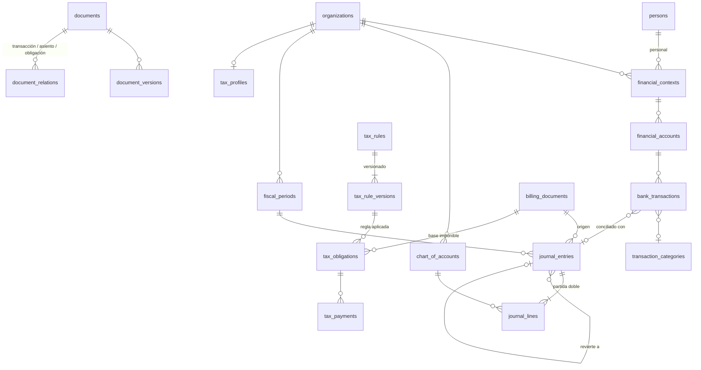

# Esquema de base de datos

PostgreSQL 18. Migraciones en `backend/migrations` (Alembic). Convenciones:

- PK `uuid` con `uuidv7()` (ordenadas por tiempo). Excepción: catálogos con código natural (`roles.code`, `permissions.code`).
- `timestamptz` en todas las fechas-hora; `date` para fechas contables y fiscales.
- Importes `NUMERIC(18,2)` + `currency char(3)` (D-026; desde la fase 2). Nunca `float`.
- Nombres de restricciones estables (`pk_`, `fk_`, `uq_`, `ck_`, `ix_`).
- Soft delete **no** se usa por defecto: los registros contables no se borran (se revierten), los movimientos financieros se anulan (`voided_at`) y los maestros se desactivan o archivan (`is_active`, `archived_at`).
- Todo dato de negocio lleva `organization_id`.

## Implementado (migración `0001`)

### Restricciones e invariantes en la base
| Objeto | Regla |
|---|---|
| `uq_users_email_lower` | Email único sin distinguir mayúsculas |
| `ck_organizations_ruc_*` | RUC 1-8 dígitos, DV 1 dígito, ambos o ninguno |
| `uq_organization_members_organization_id_user_id` | Una membresía por usuario y organización |
| `ck_user_sessions_expires_after_creation` | Vencimiento posterior a la creación |
| `audit.chain_audit_log()` (trigger) | Asigna `seq` y la cadena de hashes bajo candado |
| `audit.reject_change()` (triggers) | `audit_logs` y `security_events`: sin UPDATE, DELETE ni TRUNCATE |
| `audit.log_row_hash()` | Hash canónico (lo usan el trigger y la verificación) |

### Datos iniciales (en la misma migración)
Permisos `organization.read`, `organization.manage`, `users.read`, `users.manage`, `audit.read`; roles `owner`, `admin`, `accountant`, `viewer` y sus vínculos. Una prueba verifica que coincidan con `app/core/permissions.py`.

## Implementado (migración `0002` — finanzas)

Esquema `finance`. Especificación: `docs/specs/FASE2_FINANZAS.md` (D-023 a D-027). Todas las tablas llevan `id uuid` (`uuidv7()`), `created_at` y `updated_at`.

### Restricciones e invariantes en la base (finanzas)
| Objeto | Regla |
|---|---|
| `uq_contexts_business_per_org` (parcial) | Exactamente un contexto `business` por organización |
| `uq_contexts_personal_per_user` (parcial) | Como máximo un contexto `personal` por usuario y organización |
| `ck_contexts_owner_matches_kind` | `owner_user_id` NULL si `business`, obligatorio si `personal` |
| `uq_{accounts,categories,counterparties,import_batches}_id_context_id` | Destino de las claves foráneas compuestas (D-025) |
| `uq_accounts_id_context_id_currency` | Destino de la FK que fija la moneda del movimiento |
| `fk_transactions_account_id_accounts` | `(account_id, context_id, currency)`: la cuenta es del mismo contexto y de la misma moneda; además impide cambiar la moneda de una cuenta con movimientos |
| `fk_transactions_{category,counterparty,import_batch}_id_*` | `(x_id, context_id)`: del mismo contexto |
| `fk_categories_parent_id_categories` | `(parent_id, context_id)`: el padre es del mismo contexto (el nivel único se valida en el servicio) |
| `fk_import_batches_account_id_accounts` | `(account_id, context_id)` |
| `uq_accounts_context_id_name` | Nombre de cuenta único por contexto |
| `uq_categories_context_id_parent_id_name` | `NULLS NOT DISTINCT`: nombre único por nivel |
| `uq_counterparties_ruc_per_context` (parcial) | Un RUC por contexto |
| `ck_counterparties_ruc_*` | Mismas reglas de RUC y DV que `core.organizations` |
| `ck_accounts_currency_valid` | Catálogo de monedas de `finance/money.py` |
| `ck_accounts_number_last4_digits` | Solo los últimos 4 dígitos, nunca el número completo |
| `ck_accounts_pyg_integer`, `ck_transactions_pyg_integer` | PYG sin decimales |
| `ck_transactions_amount_not_zero` | Importe distinto de cero |
| `ck_transactions_import_has_batch` | `source = 'import'` si y solo si hay lote |
| `ck_transactions_void_complete`, `ck_transactions_void_reason_length` | Anulación: fecha, usuario y motivo juntos; motivo de 3 caracteres o más |
| `ck_transactions_transfer_without_category` | Una transferencia no lleva categoría |
| `ck_import_batches_committed` | `committed_at` si y solo si `status = 'committed'` |
| `uq_import_rows_batch_id_row_number` | Una fila por número dentro del lote |
| `ix_transactions_context_booked` | `(context_id, booked_on DESC, id DESC)`: listado paginado |
| `ix_transactions_account_dedupe` | `(account_id, dedupe_key)` **no único**: el duplicado se señala, no se prohíbe |

### Datos iniciales (migración `0002`)
Permisos `finance.read` (owner, admin, accountant, viewer) y `finance.manage` (owner, admin, accountant), y el contexto `business` ("Empresa") de cada organización existente. Los permisos se insertan con `ON CONFLICT DO NOTHING` porque la `0001` carga el catálogo vivo de `app/core/permissions.py` (en una base nueva ya los trae).

## Modelo objetivo (fases 3 a 7)

Se implementa por fases; cada tabla nace con su migración, su prueba y su pantalla. Lo que sigue es el diseño de referencia y **se revisará** en cada fase.

### Decisiones de modelado clave
- **Contexto financiero**: implementado en la fase 2 como `finance.contexts` (ver arriba). En la fase 3, los asientos referenciarán el contexto `business` con la misma técnica de claves foráneas compuestas. Lo consolidado es una **vista**, nunca datos mezclados.
- **Asientos**: `journal_entries.status ∈ {draft, posted, reversed}`. Un trigger rechaza modificar líneas de un asiento `posted` y contabilizar en un período cerrado; otro valida `Σ debe = Σ haber` por moneda al pasar a `posted`. La corrección es un asiento de reversión (`reverses_entry_id`).
- **Reglas tributarias**: `tax_rule_versions` con `valid_from`, `valid_to`, `source_url`, `legal_reference`, `published_at`, `consulted_at`, `validation_status ∈ {pending, verified, deprecated}`, `reviewed_by`. Las obligaciones guardan la versión aplicada. Se cargan como datos, no como código.
- **Facturación**: esquema `billing` propio del servicio SIFEN (fase 5), referenciado desde contabilidad y tributación por `billing_documents.id`.
- **IA**: `ai.ai_interactions`, `ai.ai_tool_executions` (entrada, salida, duración, usuario) y `ai.ai_approvals` (borrador → aprobado/rechazado por un humano).
